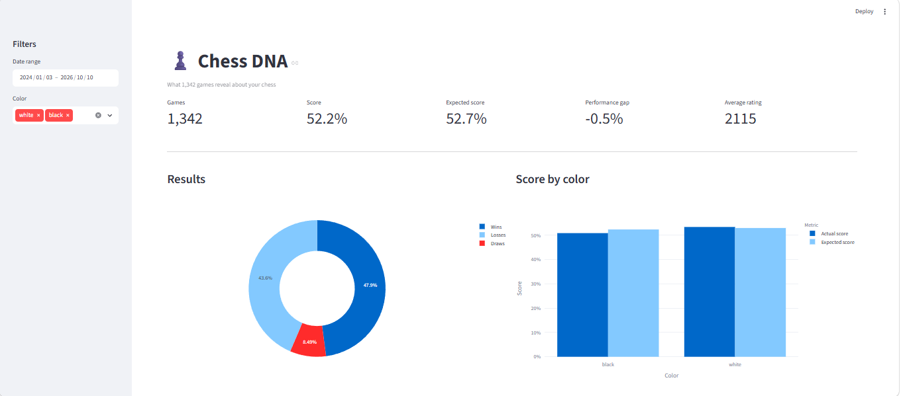

# Chess DNA: What 1,342 Games Reveal About My Chess

An end-to-end personal analytics project exploring chess performance through real game data. Built with Python, pandas, python-chess, Streamlit, and Plotly.

## Dashboard Preview



Explore the interactive dashboard to analyze results, performance by color, rating progression, opponent strength, and opening performance.

## Overview

Chess DNA turns my Lichess rapid games into an interactive analytics dashboard. The project demonstrates how raw data can be collected, transformed, validated, analyzed, and presented to support evidence-based decisions.

Rather than looking only at wins and losses, it explores performance patterns across colors, opponent rating ranges, and openings.

## Key Questions

- Do I perform differently with White and Black?
- How does my actual score compare with the score expected from Elo ratings?
- Against which opponent rating ranges do I overperform or underperform?
- Which openings have produced the strongest results in my games?
- How has my rating evolved over time?

## Technology Stack

- **Python:** data extraction, transformation, analysis, and testing.
- **pandas:** data manipulation and statistical summaries.
- **python-chess:** PGN parsing and chess game metadata.
- **Streamlit:** interactive dashboard.
- **Plotly:** interactive data visualizations.
- **Lichess API:** source of game data.
- **unittest:** automated tests for core calculations and game parsing.

## Data Pipeline

1. **Extraction:** retrieve rapid games from the Lichess API and save the raw PGN locally.
2. **Transformation:** parse game metadata and moves into structured CSV datasets.
3. **Analysis:** calculate performance metrics, expected scores, rating trends, and opening statistics.
4. **Visualization:** explore the results through an interactive Streamlit dashboard.
5. **Validation:** run automated tests for Elo-based expected scores and score calculations from the player's perspective.

## Preliminary Findings

The current dataset contains 1,342 rapid games dated between January 3, 2024, and October 10, 2026.

| Metric | Result |
|---|---:|
| Games analyzed | 1,342 |
| Wins | 643 |
| Draws | 114 |
| Losses | 585 |
| Actual score | 52.2% |
| Elo-expected score | 52.7% |
| Actual vs. expected score | -0.5 percentage points |
| Average recorded player rating | 2,114.9 |

### Performance by Color

- **White:** 53.4% actual score.
- **Black:** 50.9% actual score.

The observed difference is 2.5 percentage points in favor of White. This is a descriptive result, not proof that color alone explains the difference.

### Performance Against Stronger Opponents

Against opponents rated between 2,200 and 2,399, the actual score was 31.1%, compared with an Elo-expected score of 35.4%. This represents a gap of -4.3 percentage points across 132 games.

### Opening Performance

Opening statistics compare actual and expected scores, with a minimum game-count threshold to reduce the influence of very small samples. Results should be interpreted cautiously: opening performance is observational and does not establish causation.

## Project Structure

```text
chess-dna/
├── app.py
├── requirements.txt
├── src/
│   └── chess_dna/
│       ├── __init__.py
│       ├── extract.py
│       ├── transform.py
│       └── analysis.py
├── tests/
│   └── test_chess_dna.py
├── data/
│   ├── raw/
│   └── processed/
└── README.md
```

Raw and processed datasets are excluded from version control. The directories are retained with `.gitkeep` files.

## Getting Started

### 1. Clone the repository

```bash
git clone https://github.com/YOUR_USERNAME/chess-dna.git
cd chess-dna
```

Replace `YOUR_USERNAME` with the GitHub account that hosts this repository.

### 2. Create and activate a virtual environment

On Windows with Git Bash:

```bash
python -m venv .venv
source .venv/Scripts/activate
```

### 3. Install dependencies

```bash
python -m pip install -r requirements.txt
```

### 4. Extract and process the data

Review `src/chess_dna/extract.py` and set the Lichess username to the account you want to analyze.

Then run:

```bash
python src/chess_dna/extract.py
python src/chess_dna/transform.py
python src/chess_dna/analysis.py
```

The scripts create local raw and processed datasets. These files are intentionally excluded from Git.

### 5. Launch the dashboard

```bash
streamlit run app.py
```

Streamlit will provide a local URL, typically `http://localhost:8501`.

### 6. Run the tests

```bash
python -m unittest discover -s tests -v
```

## Privacy and Reproducibility

This repository does not include my raw PGN file or processed game datasets. Game data must be generated locally by running the extraction and processing scripts.

The project uses the Lichess API to retrieve games associated with a specified account. Review the API documentation and applicable terms before using the project for other purposes.

## Limitations

- The analysis is descriptive and does not establish causal relationships.
- Opening results depend on sample size, opponent strength, and the specific positions reached.
- Elo-expected scores provide a rating-based benchmark, not a chess-engine evaluation of move quality.
- The dashboard requires locally generated datasets; these are not committed to the repository.

## Future Improvements

- Add deeper time-control and time-management analysis.
- Improve rating trend calculations using precise game timestamps.
- Explore move-level patterns and blunder analysis using chess-engine evaluations.
- Add further automated data-quality checks.
- Publish a demo with a separate, non-personal sample dataset.

## Author

A data analytics portfolio project combining data engineering, statistical analysis, software testing, and interactive visualization.